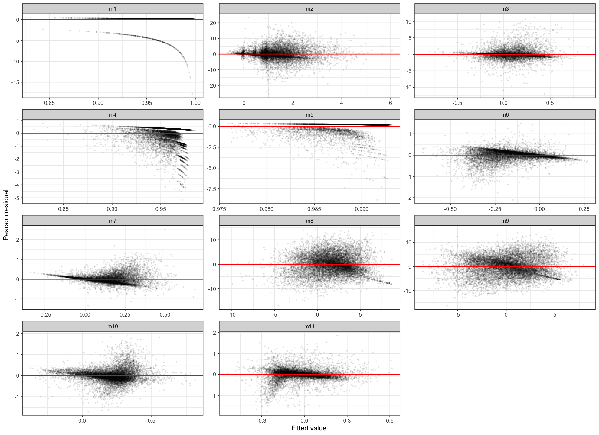

# Scope and changes from v0.3

This report extends `reintrov_0.3.Rmd` with two log-ratio evenness models,
`m10` (extirpation/intact) and `m11` (reintroduction/extirpation). The first
nine model formulas are retained. The new fits implement the evenness-model
specification in the manuscript; they are newly reconstructed analyses, not
recovered historical results.

Three manuscript figures are rebuilt: community responses to extirpation
(four rows), predator responses to reintroduction (three rows), and community
responses to reintroduction (four rows). Colours, scenario order, intact
reference panels, dashed reference lines, and circle/square comparisons follow
the Google Docs figures. Values are calculated from the fitted models, not
traced from the old images. Explicit scenario values follow their captions.

Important corrections are documented rather than hidden:

* Predator biomass and stability are conditional on establishment. Failed
  predators within the inherited cohort remain in the binary establishment model. Zero biomass cannot be
  logged; v0.3 attempted to do so for some failures.
* "Short" and "Tall" now map to low and high trophic height respectively;
  v0.3's prediction table reversed those labels.
* Figure reference values (50 species, biomass 100, stability 0.1 and evenness
  0.1) are illustrative, not measured ecosystem averages or physical units.
  Inverse-CV stability 0.1 means CV = 10, not 10%.
* For Figure 3, uncertainty in both sequential transitions is propagated with
  paired resampling of simulation records. Multiplying two separate interval
  endpoints, as in v0.3, does not give a calibrated interval for their product.
* These confidence intervals describe conditional model predictions within
  the simulated ensemble. They are not prediction intervals for real releases.

# Input, phases and analysis population


|stage                                    | simulations|
|:----------------------------------------|-----------:|
|Input                                    |       69895|
|Finite predator biomass ratio            |       66959|
|Baseline: no imposed feeding-link change |       10969|

Each row is one simulation trajectory across three phases: intact (1),
extirpated (2) and reintroduced (3). Suffixes `21` and `32` denote ratios
between consecutive phases; `31` compares reintroduced with intact. Evenness
ratios can exceed one, so they are analysed with log-normal linear models,
not beta regression. The data contain evenness measurements but not saved
historical evenness-model fits. `DATA_DICTIONARY.csv` in the repository
describes the input columns.

For comparability, v0.4 retains v0.3's global finite-biomass-ratio filter.
Before that filter there are 11614 baseline records;
645 are excluded by it.
Consequently, the binary establishment model is conditional on the retained
analysis cohort, not every attempted simulation. This selection and missing
simulation outputs should be considered when interpreting establishment rates.


# Eleven statistical models


|    |model |family                |
|:---|:-----|:---------------------|
|m1  |m1    |binomial logit        |
|m2  |m2    |Gaussian on log ratio |
|m3  |m3    |Gaussian on log ratio |
|m4  |m4    |beta logit            |
|m5  |m5    |beta logit            |
|m6  |m6    |Gaussian on log ratio |
|m7  |m7    |Gaussian on log ratio |
|m8  |m8    |Gaussian on log ratio |
|m9  |m9    |Gaussian on log ratio |
|m10 |m10   |Gaussian on log ratio |
|m11 |m11   |Gaussian on log ratio |


```
#> Warning in family$saturated.ll(y, prior.weights, theta): saturated
#> likelihood may be inaccurate

#> Warning in family$saturated.ll(y, prior.weights, theta): saturated
#> likelihood may be inaccurate
```

```
#> <environment: 0x108c81d28>
```


|    |model |family                |     n| excluded_from_baseline|
|:---|:-----|:---------------------|-----:|----------------------:|
|m1  |m1    |binomial logit        | 10969|                      0|
|m2  |m2    |Gaussian on log ratio | 10607|                    362|
|m3  |m3    |Gaussian on log ratio | 10602|                    367|
|m4  |m4    |beta logit            | 10969|                      0|
|m5  |m5    |beta logit            | 10969|                      0|
|m6  |m6    |Gaussian on log ratio | 10969|                      0|
|m7  |m7    |Gaussian on log ratio | 10969|                      0|
|m8  |m8    |Gaussian on log ratio | 10969|                      0|
|m9  |m9    |Gaussian on log ratio | 10969|                      0|
|m10 |m10   |Gaussian on log ratio | 10969|                      0|
|m11 |m11   |Gaussian on log ratio | 10969|                      0|

`m1` predicts establishment; `m2` and `m3` predict predator stability and
biomass conditional on establishment. Pairs `m4/m5`, `m6/m7`, `m8/m9` and
`m10/m11` describe resident richness, total biomass, community stability and
evenness respectively. These are associations within the simulated ensemble.
In particular, conditioning on predator survival in community models does
not estimate a randomised causal effect of survival.

The richness beta regressions retain v0.3's `mgcv::betar` specification,
including its default endpoint adjustment: exact zero/one proportions are
moved just inside the unit interval (`eps = 100 * .Machine$double.eps`).
There are 5809 exact-one extirpation ratios and
8835 exact-one reintroduction ratios. This substantial
boundary mass is a limitation of the inherited beta models; a boundary-aware
alternative would be a separate sensitivity analysis, not a silent change
to the manuscript's established specification.


# Explicit manuscript scenarios


|Factor                  |Left   |   Value|Right    | Value|
|:-----------------------|:------|-------:|:--------|-----:|
|Community
connectance    |Strong |    0.09|Weak     |  0.06|
|Community
intactness     |Intact |    1.00|Depleted |  0.50|
|Food-web
trophic height  |Short  |    2.05|Tall     |  3.43|
|Mass ratio
Predator:Prey |Large  | 1000.00|Small    | 10.00|
|Predator
diet breadth    |Large  |   12.00|Small    |  1.00|
|Predator
survival        |High   |    1.00|Low      |  0.00|
|Prey
intactness          |Intact |    1.00|Depleted |  0.50|

These profiles hold unspecified predictors fixed; they do not represent
observed whole communities. Reference log-stability is the mean of logged
stability. Prey intactness, community intactness and survival can therefore
be varied as conditional covariates without simulating a new community.
Some settings are unusual combinations; predictions are not empirical
recommendations about optimal release conditions.
If a scenario variable is absent from a model, changing it leaves that
model's prediction unchanged. For example, the predator-survival setting is
not a predictor in the population models; its identical Figure 2 points
are retained to follow the manuscript's seven-column layout.
Each regression is evaluated separately. A prescribed intactness value in
a second-transition model need not equal the first-transition richness
prediction at the reference profile. Consequently, products of these
predictions are illustrative model comparisons, not reconstructions of a
single internally constrained food-web trajectory.


# Sequential community responses and uncertainty


The paired bootstrap uses 200 successful resamples out of
200, with seed 20261103. It resamples whole simulation records, not
time steps. It assumes the retained simulation records can be treated as
independent sampling units. It does not include uncertainty in the chosen
reference profile or in the underlying food-web parameterisation. More
replicates can be requested through the `bootstrap_replicates` parameter.

200 resamples generated numerical warnings,
recorded in `bootstrap_status.csv`. In particular, saturated-likelihood
warnings from the inherited beta family must be considered alongside the
large mass at persistence = 1; convergence alone does not establish that
this distributional specification is appropriate.


|warning                                | replicates|
|:--------------------------------------|----------:|
|saturated likelihood may be inaccurate |        200|


# Rebuilt manuscript figures


## Figure 1: community responses to extirpation


Conditional community responses to predator extirpation. Four metrics and four scenario pairs follow the manuscript layout. Dots are model predictions; intervals are 95% paired-bootstrap intervals. Dashed lines show illustrative intact reference values. Stability uses a logarithmic axis.


## Figure 2: predator responses to reintroduction


Predator establishment probability, biomass and temporal stability. Biomass and stability predictions are conditional on predator establishment. Intervals are pointwise 95% model confidence intervals, transformed from the link/log scale. The population reference values are probability 1, biomass 10 and inverse-CV stability 0.1.


## Figure 3: community responses after reintroduction


Community responses on a common intact-reference scale. Transparent circles show post-extirpation predictions and opaque squares show post-reintroduction predictions. Reintroduction values combine both sequential model ratios. Intervals propagate their dependence using the paired bootstrap. Evenness is newly reconstructed in v0.4.


# Model diagnostics and detailed results


|Model |     n|          AIC| Residual SD| Max residual|Converged |
|:-----|-----:|------------:|-----------:|------------:|:---------|
|m1    | 10969|    3037.1941|      1.0172|      17.8051|TRUE      |
|m2    | 10607|   56950.1770|      3.5421|      25.5156|TRUE      |
|m3    | 10602|   35703.6031|      1.3021|      11.9756|TRUE      |
|m4    | 10969| -306890.0889|      0.6657|       5.1658|TRUE      |
|m5    | 10969| -475997.5872|      0.6530|       8.8436|TRUE      |
|m6    | 10969|    -619.7618|      0.2350|       2.1044|TRUE      |
|m7    | 10969|   -1888.1941|      0.2218|       2.5108|TRUE      |
|m8    | 10969|   60850.3983|      3.8730|      16.9453|TRUE      |
|m9    | 10969|   60657.0233|      3.8383|      16.3696|TRUE      |
|m10   | 10969|    5418.5103|      0.3095|       1.9087|TRUE      |
|m11   | 10969|    1695.5238|      0.2612|       1.8680|TRUE      |


 


## m1

Formula:

```
 delta_sp_32 ~ realised_C_1 * realised_S_1 + g_1 * delta_g_31 +
delta_s_21 + z_1 
```

```
 
Call:
glm(formula = model_formulas[[id]], family = binomial(link = "logit"), 
    data = data)

Deviance Residuals: 
    Min       1Q   Median       3Q      Max  
-3.3947   0.1720   0.2369   0.2999   0.6097  

Coefficients:
                            Estimate Std. Error z value Pr(>|z|)    
(Intercept)                1.3263038  0.7592107   1.747 0.080646 .  
realised_C_1              -0.1477199  1.5178120  -0.097 0.922469    
realised_S_1               0.0137905  0.0094220   1.464 0.143289    
g_1                        0.0516643  0.0485779   1.064 0.287539    
delta_g_31                 0.2239613  0.3624661   0.618 0.536653    
delta_s_21                 1.2951460  0.6750597   1.919 0.055039 .  
z_1                        0.0014682  0.0002306   6.366 1.94e-10 ***
realised_C_1:realised_S_1 -0.2923196  0.0786419  -3.717 0.000202 ***
g_1:delta_g_31             0.1588710  0.0680804   2.334 0.019618 *  
---
Signif. codes:  0 '***' 0.001 '**' 0.01 '*' 0.05 '.' 0.1 ' ' 1

(Dispersion parameter for binomial family taken to be 1)

    Null deviance: 3174.9  on 10968  degrees of freedom
Residual deviance: 3019.2  on 10960  degrees of freedom
AIC: 3037.2

Number of Fisher Scoring iterations: 7
 
```


## m2

Formula:

```
 log(delta_stabp_31) ~ realised_C_1 * realised_S_1 + g_1 * delta_g_31 +
delta_s_21 + z_1 
```

```
 
Call:
lm(formula = model_formulas[[id]], data = data)

Residuals:
     Min       1Q   Median       3Q      Max 
-25.5156  -1.4809  -0.3306   1.4118  23.3318 

Coefficients:
                            Estimate Std. Error t value Pr(>|t|)    
(Intercept)                6.2239239  0.5381725  11.565  < 2e-16 ***
realised_C_1               1.6978738  0.9150960   1.855 0.063566 .  
realised_S_1               0.0219007  0.0056689   3.863 0.000113 ***
g_1                        0.1200170  0.0266358   4.506 6.68e-06 ***
delta_g_31                -0.8878407  0.2498271  -3.554 0.000381 ***
delta_s_21                -4.5417159  0.4968707  -9.141  < 2e-16 ***
z_1                       -0.0009494  0.0001077  -8.815  < 2e-16 ***
realised_C_1:realised_S_1 -0.2449197  0.0511673  -4.787 1.72e-06 ***
g_1:delta_g_31            -0.1183862  0.0353658  -3.347 0.000818 ***
---
Signif. codes:  0 '***' 0.001 '**' 0.01 '*' 0.05 '.' 0.1 ' ' 1

Residual standard error: 3.543 on 10598 degrees of freedom
Multiple R-squared:  0.04841,	Adjusted R-squared:  0.04769 
F-statistic: 67.39 on 8 and 10598 DF,  p-value: < 2.2e-16
 
```


## m3

Formula:

```
 log(delta_bmp_31) ~ realised_C_1 * realised_S_1 + g_1 * delta_g_31 +
delta_s_21 + z_1 
```

```
 
Call:
lm(formula = model_formulas[[id]], data = data)

Residuals:
     Min       1Q   Median       3Q      Max 
-11.9756  -0.3904  -0.0878   0.1506  11.1059 

Coefficients:
                            Estimate Std. Error t value Pr(>|t|)    
(Intercept)                1.810e-01  1.979e-01   0.915 0.360441    
realised_C_1               1.156e+00  3.365e-01   3.434 0.000597 ***
realised_S_1               5.643e-04  2.087e-03   0.270 0.786815    
g_1                        2.327e-02  9.792e-03   2.377 0.017489 *  
delta_g_31                -4.233e-01  9.187e-02  -4.607 4.12e-06 ***
delta_s_21                 3.517e-01  1.827e-01   1.925 0.054212 .  
z_1                       -9.206e-05  3.960e-05  -2.325 0.020107 *  
realised_C_1:realised_S_1 -5.839e-02  1.882e-02  -3.103 0.001923 ** 
g_1:delta_g_31            -5.255e-02  1.300e-02  -4.041 5.35e-05 ***
---
Signif. codes:  0 '***' 0.001 '**' 0.01 '*' 0.05 '.' 0.1 ' ' 1

Residual standard error: 1.303 on 10593 degrees of freedom
Multiple R-squared:  0.01855,	Adjusted R-squared:  0.01781 
F-statistic: 25.03 on 8 and 10593 DF,  p-value: < 2.2e-16
 
```


## m4

Formula:

```
 delta_s_21 ~ realised_C_1 * realised_S_1 + g_1 + z_1 + stab_com_1 +
tlvl_mean_1 
```

```
 
Family: Beta regression(1.609) 
Link function: logit 

Formula:
delta_s_21 ~ realised_C_1 * realised_S_1 + g_1 + z_1 + stab_com_1 + 
    tlvl_mean_1

Parametric coefficients:
                            Estimate Std. Error z value Pr(>|z|)    
(Intercept)                3.459e+00  8.575e-02  40.341  < 2e-16 ***
realised_C_1               2.016e+00  2.592e-01   7.777 7.45e-15 ***
realised_S_1               1.114e-03  1.644e-03   0.677  0.49816    
g_1                       -3.375e-02  2.370e-03 -14.241  < 2e-16 ***
z_1                        1.095e-04  3.461e-05   3.163  0.00156 ** 
stab_com_1                 1.267e-02  2.479e-03   5.112 3.19e-07 ***
tlvl_mean_1               -2.133e-02  2.490e-02  -0.857  0.39171    
realised_C_1:realised_S_1 -1.951e-01  1.610e-02 -12.115  < 2e-16 ***
---
Signif. codes:  0 '***' 0.001 '**' 0.01 '*' 0.05 '.' 0.1 ' ' 1


R-sq.(adj) =  0.0476   Deviance explained = -1.55%
-REML = -1.5342e+05  Scale est. = 1         n = 10969 
```


## m5

Formula:

```
 delta_s_32 ~ realised_C_1 * realised_S_1 + delta_s_21 + g_1 + z_1 +
tlvl_mean_1 + delta_sp_32 + stab_com_2 
```

```
 
Family: Beta regression(3.837) 
Link function: logit 

Formula:
delta_s_32 ~ realised_C_1 * realised_S_1 + delta_s_21 + g_1 + 
    z_1 + tlvl_mean_1 + delta_sp_32 + stab_com_2

Parametric coefficients:
                            Estimate Std. Error z value Pr(>|z|)    
(Intercept)                4.440e+00  1.572e-01  28.246  < 2e-16 ***
realised_C_1              -1.335e-02  2.541e-01  -0.053 0.958119    
realised_S_1              -9.222e-03  1.598e-03  -5.771 7.86e-09 ***
delta_s_21                 2.146e-01  1.270e-01   1.690 0.091065 .  
g_1                        6.161e-03  2.313e-03   2.664 0.007718 ** 
z_1                       -1.253e-04  3.302e-05  -3.793 0.000149 ***
tlvl_mean_1                4.980e-05  2.442e-02   0.002 0.998373    
delta_sp_32                3.043e-02  5.439e-02   0.560 0.575777    
stab_com_2                 1.193e-02  2.281e-03   5.230 1.70e-07 ***
realised_C_1:realised_S_1 -6.031e-02  1.566e-02  -3.852 0.000117 ***
---
Signif. codes:  0 '***' 0.001 '**' 0.01 '*' 0.05 '.' 0.1 ' ' 1


R-sq.(adj) =  0.0363   Deviance explained = -0.24%
-REML = -2.3797e+05  Scale est. = 1         n = 10969 
```


## m6

Formula:

```
 log(delta_bmc_21) ~ realised_C_1 * realised_S_1 + g_1 + z_1 +
stab_com_1 + tlvl_mean_1 
```

```
 
Call:
lm(formula = model_formulas[[id]], data = data)

Residuals:
     Min       1Q   Median       3Q      Max 
-2.10440 -0.08519  0.03050  0.13175  1.47894 

Coefficients:
                            Estimate Std. Error t value Pr(>|t|)    
(Intercept)                2.956e-01  1.948e-02  15.170  < 2e-16 ***
realised_C_1              -1.863e-01  5.912e-02  -3.151  0.00163 ** 
realised_S_1               1.166e-03  3.724e-04   3.132  0.00174 ** 
g_1                       -2.026e-02  5.294e-04 -38.265  < 2e-16 ***
z_1                       -1.138e-04  7.862e-06 -14.471  < 2e-16 ***
stab_com_1                -1.457e-02  5.644e-04 -25.825  < 2e-16 ***
tlvl_mean_1               -1.028e-01  5.636e-03 -18.243  < 2e-16 ***
realised_C_1:realised_S_1  6.759e-02  3.630e-03  18.620  < 2e-16 ***
---
Signif. codes:  0 '***' 0.001 '**' 0.01 '*' 0.05 '.' 0.1 ' ' 1

Residual standard error: 0.2351 on 10961 degrees of freedom
Multiple R-squared:  0.2454,	Adjusted R-squared:  0.2449 
F-statistic: 509.1 on 7 and 10961 DF,  p-value: < 2.2e-16
 
```


## m7

Formula:

```
 log(delta_bmc_32) ~ realised_C_1 * realised_S_1 + delta_s_21 + g_1 +
z_1 + tlvl_mean_1 + delta_sp_32 + stab_com_2 
```

```
 
Call:
lm(formula = model_formulas[[id]], data = data)

Residuals:
     Min       1Q   Median       3Q      Max 
-1.34284 -0.12480 -0.03076  0.07787  2.51077 

Coefficients:
                            Estimate Std. Error t value Pr(>|t|)    
(Intercept)                3.256e-01  3.454e-02   9.425  < 2e-16 ***
realised_C_1               3.806e-01  5.589e-02   6.811 1.02e-11 ***
realised_S_1              -1.637e-03  3.508e-04  -4.667 3.09e-06 ***
delta_s_21                -5.224e-01  2.791e-02 -18.718  < 2e-16 ***
g_1                        1.777e-02  5.080e-04  34.989  < 2e-16 ***
z_1                        9.188e-05  7.252e-06  12.669  < 2e-16 ***
tlvl_mean_1                8.595e-02  5.365e-03  16.022  < 2e-16 ***
delta_sp_32                8.905e-02  1.195e-02   7.452 9.91e-14 ***
stab_com_2                 1.689e-03  5.016e-04   3.368  0.00076 ***
realised_C_1:realised_S_1 -7.511e-02  3.437e-03 -21.855  < 2e-16 ***
---
Signif. codes:  0 '***' 0.001 '**' 0.01 '*' 0.05 '.' 0.1 ' ' 1

Residual standard error: 0.2219 on 10959 degrees of freedom
Multiple R-squared:  0.2361,	Adjusted R-squared:  0.2355 
F-statistic: 376.4 on 9 and 10959 DF,  p-value: < 2.2e-16
 
```


## m8

Formula:

```
 log(delta_stabc_21) ~ realised_C_1 * realised_S_1 + g_1 + z_1 +
stab_com_1 + tlvl_mean_1 
```

```
 
Call:
lm(formula = model_formulas[[id]], data = data)

Residuals:
     Min       1Q   Median       3Q      Max 
-16.9453  -2.4566  -0.0581   2.4704  14.1978 

Coefficients:
                            Estimate Std. Error t value Pr(>|t|)    
(Intercept)               15.0696960  0.3210290  46.942  < 2e-16 ***
realised_C_1               5.6412348  0.9742157   5.791 7.21e-09 ***
realised_S_1              -0.0138951  0.0061355  -2.265   0.0235 *  
g_1                       -0.0766990  0.0087234  -8.792  < 2e-16 ***
z_1                       -0.0010868  0.0001296  -8.389  < 2e-16 ***
stab_com_1                -0.5672360  0.0092991 -60.999  < 2e-16 ***
tlvl_mean_1               -1.5498226  0.0928679 -16.688  < 2e-16 ***
realised_C_1:realised_S_1 -0.6563143  0.0598165 -10.972  < 2e-16 ***
---
Signif. codes:  0 '***' 0.001 '**' 0.01 '*' 0.05 '.' 0.1 ' ' 1

Residual standard error: 3.874 on 10961 degrees of freedom
Multiple R-squared:  0.2762,	Adjusted R-squared:  0.2757 
F-statistic: 597.4 on 7 and 10961 DF,  p-value: < 2.2e-16
 
```


## m9

Formula:

```
 log(delta_stabc_32) ~ realised_C_1 * realised_S_1 + delta_s_21 + g_1 +
z_1 + tlvl_mean_1 + delta_sp_32 + stab_com_2 
```

```
 
Call:
lm(formula = model_formulas[[id]], data = data)

Residuals:
     Min       1Q   Median       3Q      Max 
-16.3696  -2.5764   0.0764   2.5542  15.3545 

Coefficients:
                            Estimate Std. Error t value Pr(>|t|)    
(Intercept)               18.0007077  0.5978007  30.112   <2e-16 ***
realised_C_1              -1.4900021  0.9670935  -1.541    0.123    
realised_S_1              -0.0064243  0.0060707  -1.058    0.290    
delta_s_21                -5.3125451  0.4830032 -10.999   <2e-16 ***
g_1                        0.1103430  0.0087904  12.553   <2e-16 ***
z_1                       -0.0033898  0.0001255 -27.010   <2e-16 ***
tlvl_mean_1               -1.1711224  0.0928349 -12.615   <2e-16 ***
delta_sp_32                0.0125349  0.2068073   0.061    0.952    
stab_com_2                -0.5340021  0.0086805 -61.518   <2e-16 ***
realised_C_1:realised_S_1 -0.4996927  0.0594779  -8.401   <2e-16 ***
---
Signif. codes:  0 '***' 0.001 '**' 0.01 '*' 0.05 '.' 0.1 ' ' 1

Residual standard error: 3.84 on 10959 degrees of freedom
Multiple R-squared:  0.3135,	Adjusted R-squared:  0.3129 
F-statistic:   556 on 9 and 10959 DF,  p-value: < 2.2e-16
 
```


## m10

Formula:

```
 log(delta_ev_21) ~ realised_C_1 * realised_S_1 + g_1 + z_1 + stab_com_1
+ tlvl_mean_1 
```

```
 
Call:
lm(formula = model_formulas[[id]], data = data)

Residuals:
     Min       1Q   Median       3Q      Max 
-1.71016 -0.14764 -0.01512  0.13125  1.90873 

Coefficients:
                            Estimate Std. Error t value Pr(>|t|)    
(Intercept)                4.676e-01  2.566e-02  18.226  < 2e-16 ***
realised_C_1               2.105e-01  7.786e-02   2.704  0.00686 ** 
realised_S_1              -8.799e-05  4.903e-04  -0.179  0.85759    
g_1                        2.241e-02  6.972e-04  32.151  < 2e-16 ***
z_1                       -6.192e-05  1.035e-05  -5.980 2.30e-09 ***
stab_com_1                -3.080e-03  7.432e-04  -4.145 3.42e-05 ***
tlvl_mean_1               -6.374e-02  7.422e-03  -8.588  < 2e-16 ***
realised_C_1:realised_S_1 -8.035e-02  4.780e-03 -16.808  < 2e-16 ***
---
Signif. codes:  0 '***' 0.001 '**' 0.01 '*' 0.05 '.' 0.1 ' ' 1

Residual standard error: 0.3096 on 10961 degrees of freedom
Multiple R-squared:  0.1695,	Adjusted R-squared:  0.169 
F-statistic: 319.6 on 7 and 10961 DF,  p-value: < 2.2e-16
 
```


## m11

Formula:

```
 log(delta_ev_32) ~ realised_C_1 * realised_S_1 + delta_s_21 + g_1 + z_1
+ tlvl_mean_1 + delta_sp_32 + stab_com_2 
```

```
 
Call:
lm(formula = model_formulas[[id]], data = data)

Residuals:
     Min       1Q   Median       3Q      Max 
-1.78219 -0.08044  0.00533  0.09671  1.86799 

Coefficients:
                            Estimate Std. Error t value Pr(>|t|)    
(Intercept)                1.389e+00  4.068e-02  34.158  < 2e-16 ***
realised_C_1              -3.323e-01  6.580e-02  -5.050 4.49e-07 ***
realised_S_1               9.253e-05  4.131e-04   0.224  0.82274    
delta_s_21                -1.286e+00  3.286e-02 -39.121  < 2e-16 ***
g_1                       -2.015e-02  5.981e-04 -33.692  < 2e-16 ***
z_1                       -7.981e-05  8.539e-06  -9.347  < 2e-16 ***
tlvl_mean_1               -5.088e-02  6.317e-03  -8.056 8.72e-16 ***
delta_sp_32                3.643e-02  1.407e-02   2.589  0.00964 ** 
stab_com_2                -3.889e-03  5.906e-04  -6.584 4.80e-11 ***
realised_C_1:realised_S_1  5.525e-02  4.047e-03  13.652  < 2e-16 ***
---
Signif. codes:  0 '***' 0.001 '**' 0.01 '*' 0.05 '.' 0.1 ' ' 1

Residual standard error: 0.2613 on 10959 degrees of freedom
Multiple R-squared:  0.2083,	Adjusted R-squared:  0.2077 
F-statistic: 320.5 on 9 and 10959 DF,  p-value: < 2.2e-16
 
```

# Comparison with v0.3 and the manuscript images

The v0.3 formulas for `m1` to `m9` are preserved; the populations for predator
continuous responses are now explicitly restricted as described above.
The figure settings are deliberately explicit rather than recomputing caption
values from quantiles that may change with filtering. In particular, trophic
height labels are corrected and the high/low survival settings are 1 and 0.
All other predictors remain fixed at the exported reference profile.

The new evenness fits and the uncertainty correction can change points and
intervals. The Google Docs images should be replaced only after comparing
these outputs and revisiting any numerical statements that depend on them.
In particular, correcting Short/Tall changes the interpretation of the
trophic-height panels, and conditioning predator biomass on establishment
can change relationships with prey persistence. Reconstructed outputs should
not be described as exact numerical reproductions of the historical images.
This report does not silently replace the manuscript figures or rewrite its
results. Re-establishing the source revision that generated the historical
simulation data remains a separate provenance question.

# Reproducibility

Run from the repository root, with `sim.Rdata` beside this file:


```r
rmarkdown::render("reintrov_0.4.Rmd", output_format = "pdf_document")
# HTML provides a searchable report; keep_md writes the executed Markdown too.
rmarkdown::render("reintrov_0.4.Rmd", output_format = "html_document",
                  output_options = list(keep_md = TRUE))
```

PDF rendering needs Pandoc and a LaTeX installation (for example TinyTeX).
HTML rendering needs Pandoc but not LaTeX. The source shows all fitting and
plotting code. The results directory contains the eleven fitted models,
model sample sizes, coefficients, scenarios, predictions, diagnostics,
bootstrap status, and standalone figure PDFs/PNGs. Packages and versions are
reported below. No package installation or external data download is performed.


```
#> R version 4.2.3 (2023-03-15)
#> Platform: aarch64-apple-darwin20 (64-bit)
#> Running under: macOS 26.5.1
#> 
#> Matrix products: default
#> BLAS:   /Library/Frameworks/R.framework/Versions/4.2-arm64/Resources/lib/libRblas.0.dylib
#> LAPACK: /Library/Frameworks/R.framework/Versions/4.2-arm64/Resources/lib/libRlapack.dylib
#> 
#> locale:
#> [1] C.UTF-8/C.UTF-8/C.UTF-8/C/C.UTF-8/C.UTF-8
#> 
#> attached base packages:
#> [1] stats     graphics  grDevices utils     datasets  methods   base     
#> 
#> other attached packages:
#> [1] patchwork_1.2.0 ggplot2_3.5.1  
#> 
#> loaded via a namespace (and not attached):
#>  [1] knitr_1.45         magrittr_2.0.3     splines_4.2.3     
#>  [4] tidyselect_1.2.0   lattice_0.22-5     R6_2.5.1          
#>  [7] ragg_1.2.7         rlang_1.1.3        fastmap_1.1.1     
#> [10] fansi_1.0.6        dplyr_1.1.4        tools_4.2.3       
#> [13] grid_4.2.3         nlme_3.1-164       gtable_0.3.6      
#> [16] mgcv_1.9-1         xfun_0.42          utf8_1.2.4        
#> [19] cli_3.6.2          withr_3.0.1        systemfonts_1.0.5 
#> [22] htmltools_0.5.7    yaml_2.3.12        digest_0.6.34     
#> [25] tibble_3.2.1       lifecycle_1.0.4    textshaping_0.3.7 
#> [28] Matrix_1.6-5       RColorBrewer_1.1-3 farver_2.1.1      
#> [31] vctrs_0.6.5        glue_1.7.0         evaluate_0.23     
#> [34] rmarkdown_2.25     labeling_0.4.3     compiler_4.2.3    
#> [37] pillar_1.9.0       generics_0.1.3     scales_1.4.0      
#> [40] pkgconfig_2.0.3
```
